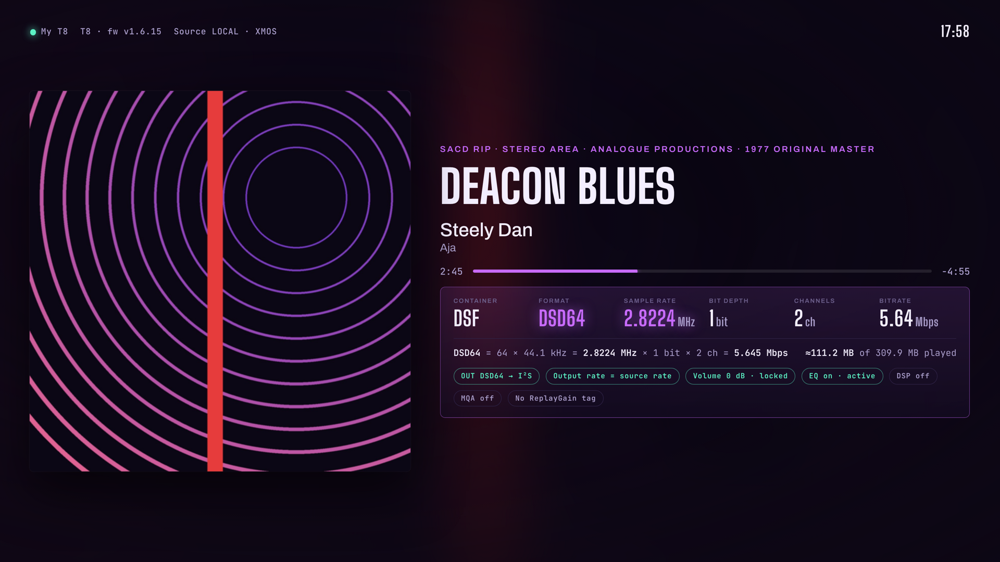
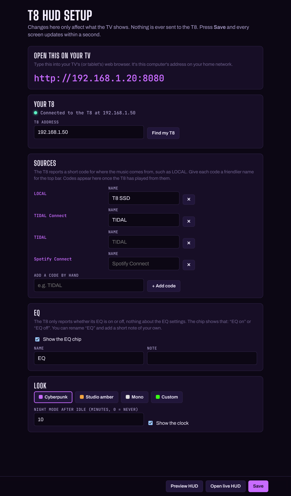

# T8 HUD

A read-only, account-free, strictly anti-enshittification “now playing” telemetry display for the Eversolo T8 streaming transport. No subscriptions, no sign-ups, no corporate servers sniffing your listening habits, no sudden UI “upgrades” that break your workflow. Just pure, unfiltered stats straight from your T8, running on your own network. The only thing it ever fetches from the internet is cover art for streamed tracks, from the streaming service’s own image server.



Big cover art and deep, live telemetry: the real stream format (DSD64 · 2.8224 MHz · 1-bit · 5.645 Mbps), container, bit depth, channels, bitrate, what the T8 is outputting and on which interface, whether the output rate matches the source, volume lock, and EQ / DSP / MQA state. It works with local files and with streaming: TIDAL in the T8's own app, TIDAL Connect, and other connect and network sources the T8 reports.

This is release 1: cover art, track info, telemetry and a clock, and nothing else. More is on the way (see **Coming later**).

**Everything on screen is real.** It's either reported by the T8 or typed in by you. There are no fake level meters or invented specs.

ZRolesLabs is NOT affiliated with Eversolo. App reads the same local HTTP API the Eversolo Control app uses (port 9529) and never sends a command to your player.

## What you need

- An Eversolo T8. The T10 and other Eversolo players will very likely work too (see **Other Eversolo players**), and reports are welcome.
- An always-on computer on the same network (Windows, Mac, Linux or a Raspberry Pi) with **Node.js 18 or newer**. It doesn't need to be your main PC: the HUD uses almost no CPU, so an old laptop, a mini PC in the media cabinet or a Raspberry Pi is plenty.
- A TV, TV box, tablet or phone with a web browser (for example TV Bro on Google TV, the TV's own built-in browser, or a tablet's browser)

There are no npm packages and no accounts, and the fonts are bundled. The only internet request is cover art for streamed tracks: the T8 hands over the streaming service's own cover link (for TIDAL, `resources.tidal.com`), and the HUD fetches that picture once and caches it. Local files get their cover straight from the T8.

## Works with

| Source | Track info | Cover art | Format telemetry |
| --- | --- | --- | --- |
| Local files (T8 SSD, USB, network shares) | yes | from the T8 | full, including file bitrate |
| TIDAL in the T8's own app | yes | TIDAL cover | full, including stream bitrate |
| TIDAL Connect | yes | TIDAL cover | rate, bit depth, channels, container. The T8 gives no bitrate, so that box shows N/A |
| Spotify Connect | yes | Spotify cover | rate, bit depth, channels. The T8 only reports the decoded PCM, so container and bitrate show N/A |
| Qobuz, HIGHRESAUDIO, Amazon Music, Deezer in the T8's own app | expected to work like in-app TIDAL (untested) | expected | expected |
| Qobuz Connect, Roon Ready, DLNA/UPnP, Squeeze Connect | expected to work like TIDAL/Spotify Connect (untested) | when the T8 provides one | what the T8 reports |
| Bluetooth, AirPlay | untested: the author's T8 runs on SFP fibre with its Wi-Fi and Bluetooth radios switched off | when the T8 provides one | what the T8 reports |

**N/A is on purpose.** When a box says **N/A · not reported by …**, the T8 simply doesn't send that value for the source. For example, with Spotify Connect the T8 only reports the decoded output (PCM 44.1/16), not whether Spotify sent Ogg or FLAC, or at what bitrate. The HUD won't fill the gap with a guess or with the decoded PCM rate dressed up as a stream bitrate. The line under the boxes still shows the real raw PCM figure.

Tested on firmware v1.6.15 with local files, in-app TIDAL, TIDAL Connect and Spotify Connect. Use one of the untested ones, or a source looks wrong? Open `http://<computer-IP>:8080/api/raw` while it plays and attach the text to an issue. That's the fastest way to get it confirmed or fixed.

## Quick start

> **Not a command-line person? [Let an AI install it for you](#let-an-ai-install-it-for-you).** Copy one prompt into an AI assistant and it walks you through every step, one at a time.

You don't need to know any IP addresses. The HUD finds your T8 by itself and tells you what to type on the TV.

Setup happens on the computer. The TV only ever opens the final address in step 5.

1. Install **Node.js** (the LTS version from [nodejs.org](https://nodejs.org)) on your always-on computer.
2. Download this repo (green **Code** button → **Download ZIP**), unzip it, and rename the folder to `t8hud`, for example `C:\t8hud`.
3. Start it from that folder:
   ```
   node server.js
   ```
   It prints the address to use, for example `On the TV, open: http://192.168.1.20:8080`.
4. On that same computer, open `http://localhost:8080/setup` in a browser. If the T8 isn't found yet, press **Find my T8**, pick it, and press **Save**. Everything else on that page is optional.
5. The top of the setup page shows **Open this on your TV**. Type that address into your TV's browser. Done.

Make sure the T8 is switched on (not in standby) and on the same network as the computer. "Same network" means the same subnet: **Find my T8** checks every address on the computer's own network, so it won't reach a T8 on a guest Wi-Fi, a separate VLAN, or a Wi-Fi with "client isolation" / "AP isolation" turned on. If it finds nothing, type the T8's address into the setup page by hand (the T8 shows it under Settings → Network Settings).

Tip: give the T8 a static IP or a router reservation. The HUD finds the T8 again by itself if its address changes, but a fixed address means no gap while it searches.

No T8 handy? `node server.js --demo` replays a recorded T8.

## Let an AI install it for you

Not a command-line person? Hand the job to an AI assistant, like [Claude](https://claude.ai/). Paste the prompt below. Fill in the two blanks if you know them; if not, leave them and the assistant will ask you.

```text
I want to install T8 HUD (https://github.com/ZRolesLabs/t8-hud), a read-only
"now playing" display for my Eversolo T8 that shows in my TV's web browser.

My always-on computer is: [Windows 11 / macOS / Raspberry Pi / Linux]
  (if I left this blank, ask me before step 1)
My TV device and browser is: [e.g. Google TV with TV Bro]
  (if I left this blank, ask me before step 5)

Read the repo's README first and follow it. Its commands are tested.

I'm not technical. Please walk me through it ONE step at a time and wait
for my reply after each step. Start every step with the device it happens
on, e.g. "[PC]" or "[TV]". Give exact clicks and copy-paste
commands, never "something like". Warn me clearly before any step that
needs an administrator / sudo window. Don't ask me for IP addresses: the
HUD finds the T8 itself and prints the address for the TV.

Steps to cover:
1. Install Node.js (LTS) and download and unzip the repo into a folder
   called t8hud.
2. Run node server.js in that folder and read me the "On the TV, open"
   address it prints.
3. Open http://localhost:8080/setup on the same computer. If my T8 isn't
   connected yet, press Find my T8 and Save. Everything else is optional.
4. Make it start at boot, using the README's "Run it at boot" recipe for
   my computer. First stop the copy from step 2 (Ctrl+C in that window),
   or the two will fight over port 8080. Allow port 8080 through the
   firewall for my local network only, and stop the computer from going
   to sleep (the recipe covers both).
5. Only now, on the TV: type the "Open this on your TV" address into
   the TV's browser. Steps 1 to 4 all happen on the computer.
6. Help me stop the TV or TV box from sleeping or going to its
   screensaver (see the README's Troubleshooting section).

If anything goes wrong at any step (T8 not found, TV can't connect,
screen goes dark, page freezes), check the README's Troubleshooting
section first, then ask me to paste the exact output before guessing.
```

## The setup page



Open it on the computer running the HUD at `http://localhost:8080/setup`, or from any phone or PC at home using the address the HUD printed when it started. The top of the page shows the address to type on your TV.

It only changes how the HUD looks. Nothing you do here changes a setting on your T8, because the HUD only ever reads from the T8.

- **Your T8:** its address, and a **Find my T8** button that scans your network.
- **Sources:** friendlier names for the source the T8 reports. For example, `LOCAL` can show as "T8 SSD", or `TIDAL Connect` as "TIDAL". A source appears in the list once the T8 has played from it, and stays there (it's remembered in `config.json`, so restarts and updates don't lose it).
- **EQ:** the T8 only reports whether its EQ is on or off, and the status chip shows that ("EQ on" / "EQ off"). You can rename the label and add a short note of your own. Untick **Show the EQ chip** to hide it.
- **Look:** the palette (Cyberpunk, Studio amber, Mono, or **Custom** with a colour you pick), night mode timing, and **Show the clock**.

At the bottom of the page:

- **Preview HUD** opens the HUD with a sample track, drawn with the settings on the page right now, before you save. It's labelled PREVIEW so nobody mistakes it for your T8.
- **Open live HUD** opens the real thing. It's greyed out until the T8 answers.

Changes only save from devices on your own network. Every open screen updates within a second.

## Tablets, phones and laptops

Any browser on your home network can show the HUD at `http://<computer-IP>:8080`, not just a TV. The screen is a fixed 16:9 frame that scales to fit:

- **Landscape** looks just like the TV. This is the way to use a tablet.
- **Portrait** works, but letterboxes with black bars top and bottom.
- For a tablet as a permanent display: set the screen timeout to **Never** (or "stay awake while charging"), and use the browser's full-screen or **Add to Home screen** option to hide the address bar.
- On a laptop or PC the mouse pointer hides after 3 seconds without movement, and comes back when you move it.

## On the TV

Every setting lives on the setup page, so there are no remote-control shortcuts to learn (TV browsers all handle remote keys differently). After a while with nothing playing, the page goes to Night by itself. It also shifts a few pixels every few minutes to protect OLED panels. If the computer reboots or the network blips, the page reconnects by itself, and it reloads by itself after you update the HUD.

## Run it at boot (Windows)

In an **administrator** PowerShell, with the HUD in `C:\t8hud`:

```powershell
$node = (Get-Command node).Source
$action = New-ScheduledTaskAction -Execute "cmd.exe" -Argument "/c `"`"$node`" server.js >> C:\t8hud\hud.log 2>&1`"" -WorkingDirectory "C:\t8hud"
$trigger = New-ScheduledTaskTrigger -AtStartup
$principal = New-ScheduledTaskPrincipal -UserId "SYSTEM" -LogonType ServiceAccount -RunLevel Highest
$settings = New-ScheduledTaskSettingsSet -ExecutionTimeLimit ([TimeSpan]::Zero) -RestartCount 999 -RestartInterval (New-TimeSpan -Minutes 1) -StartWhenAvailable
Register-ScheduledTask -TaskName "T8 HUD" -Action $action -Trigger $trigger -Principal $principal -Settings $settings -Force
New-NetFirewallRule -DisplayName "T8 HUD (LAN only)" -Direction Inbound -Protocol TCP -LocalPort 8080 -RemoteAddress LocalSubnet -Action Allow -Profile Any
Start-ScheduledTask -TaskName "T8 HUD"
```

The firewall rule matters. Windows often marks home Ethernet as a *Public* network, and without the rule the TV can't connect. It only allows devices on your own subnet.

To update later: unzip the new version over `C:\t8hud`. Then, in an admin PowerShell, run `Stop-Process -Name node -Force; Start-ScheduledTask "T8 HUD"`.

Then stop Windows from sleeping: Settings → System → Power (or Power & battery) → Screen and sleep → set every "put my device to sleep" option to **Never**. The screen can still turn off.

## Run it at boot (Raspberry Pi / Linux)

This uses systemd, which Raspberry Pi OS, Ubuntu and Debian all have. With the HUD unzipped to `~/t8hud`, paste this into a terminal (it asks for your password once, for `sudo`):

```bash
sudo tee /etc/systemd/system/t8hud.service > /dev/null <<EOF
[Unit]
Description=T8 HUD
After=network-online.target
Wants=network-online.target

[Service]
User=$USER
WorkingDirectory=$HOME/t8hud
ExecStart=$(command -v node) server.js
Restart=always
RestartSec=10

[Install]
WantedBy=multi-user.target
EOF
sudo systemctl daemon-reload
sudo systemctl enable --now t8hud
systemctl status t8hud --no-pager
```

The last line should say `active (running)`. The log is at `journalctl -u t8hud`.

- **Firewall:** Raspberry Pi OS has none switched on, so there's nothing to do. If you use `ufw`, allow your own network, for example `sudo ufw allow from 192.168.0.0/24 to any port 8080 proto tcp` (use your network's first three numbers).
- **Sleep:** a Pi never sleeps. On a desktop or laptop running Linux, `sudo systemctl mask sleep.target suspend.target hibernate.target hybrid-sleep.target` stops it.
- **To update later:** unzip the new version over `~/t8hud`, then run `sudo systemctl restart t8hud`.

## Run it at boot (Mac)

Untested by the author (no Mac here), so reports are welcome. With the HUD unzipped to `~/t8hud`, paste this into Terminal:

```bash
cat > ~/Library/LaunchAgents/com.t8hud.plist <<EOF
<?xml version="1.0" encoding="UTF-8"?>
<!DOCTYPE plist PUBLIC "-//Apple//DTD PLIST 1.0//EN" "http://www.apple.com/DTDs/PropertyList-1.0.dtd">
<plist version="1.0"><dict>
  <key>Label</key><string>com.t8hud</string>
  <key>ProgramArguments</key><array><string>$(command -v node)</string><string>server.js</string></array>
  <key>WorkingDirectory</key><string>$HOME/t8hud</string>
  <key>RunAtLoad</key><true/>
  <key>KeepAlive</key><true/>
  <key>StandardOutPath</key><string>$HOME/t8hud/hud.log</string>
  <key>StandardErrorPath</key><string>$HOME/t8hud/hud.log</string>
</dict></plist>
EOF
launchctl load ~/Library/LaunchAgents/com.t8hud.plist
```

- It starts when you log in, so turn on automatic login (System Settings → Users & Groups → Automatically log in as) if the Mac restarts on its own.
- **Firewall:** if macOS asks whether `node` may accept incoming connections, click **Allow**.
- **Sleep:** run `sudo pmset -a sleep 0`, or on a laptop, System Settings → Battery → Options → turn on "Prevent automatic sleeping on power adapter when the display is off".
- **To update later:** unzip the new version over `~/t8hud`, then run `launchctl unload ~/Library/LaunchAgents/com.t8hud.plist` followed by `launchctl load ~/Library/LaunchAgents/com.t8hud.plist`.

## Troubleshooting

- **The T8's address keeps changing.** Set a static IP on the T8 itself, under Settings → Network Settings, and keep it outside your router's DHCP pool. If the T8 sits behind a Wi-Fi bridge, a router reservation may not stick, because bridges often share one MAC between devices. The HUD also searches for the T8 if it goes missing.
- **The TV or phone times out, but `http://localhost:8080` works on the HUD computer.** Something on that computer is dropping connections from your network. The usual cause is a **VPN app** (Proton VPN, NordVPN and others): its kill switch or "block LAN" setting can block your TV even while the VPN is disconnected. Turn on the VPN's "allow LAN connections" option, quit the app, or uninstall it, then reload the page on the TV. Also check the firewall rule from the boot recipe above.
- **The whole HUD stops answering after a while (Windows).** Windows puts the computer to sleep after 30 minutes by default, and the HUD sleeps with it. Settings → System → Power (or Power & battery) → Screen and sleep → set "put my device to sleep" to **Never** (the screen can still turn off). If it still drops, open Device Manager → Network adapters → your Ethernet adapter → Power Management and untick "Allow the computer to turn off this device to save power".
- **"T8 asleep or offline".** The T8 drops its network API when it's in standby. Waking it brings the HUD back. Setting Other Settings → Power Mode → **Startup after power plug in** brings it back after a power cut.
- **The TV goes to its screensaver or switches itself off.** This is the TV, not the HUD. Smart TVs and TV boxes only stay awake for what they count as video, and a web page isn't video, so the TV's idle timer keeps running while the HUD is up. Turn the timers off on the TV or TV box itself. On Google TV, set Settings → System → Ambient mode → Start ambient mode after → **Never**, and Settings → System → Power & Energy → Energy saver (or "Turn off display") → **Never**. If the browser runs on a stick or box (Chromecast, Fire TV, Apple TV), that box's own sleep timer counts too, and with HDMI-CEC on it can switch the TV off when it sleeps. Menu names differ between models and firmware versions, so on other TVs look for "screensaver", "auto power off", "sleep timer" or "no signal power off". The HUD can't change these for you.
- **The TV page freezes after days of running.** Some TV browsers get sluggish when left open for days. The HUD page reloads itself once a day while nothing is playing; if it still freezes, close and reopen the browser. For a cleaner full-screen look, use your browser's full-screen or kiosk option (TV Bro has one in its menu).
- **The TV shows an old version.** Some TV browsers cache hard. On Google TV: Settings → Apps → TV Bro → Force stop, then Clear data, then reopen. From v0.1.5 on, this shouldn't happen.

## What the T8 does and doesn't tell us

From `getState` (firmware v1.6.15): track, artist, album, container, codec, sample rate, bit depth, channels, bitrate, file size, output codec and rate, output interface, volume and lock, EQ/DSP/sub/MQA flags, and ReplayGain when the file is tagged.

- **The T8's own player** (`playType` 5: local files and in-app TIDAL/Qobuz): the track is in `playingMusic`. Local covers come from `getImage?id=<id>&musicType=0&type=0&target=16` as a 1500 × 1500 JPEG; streamed tracks carry their own `albumArt` link. The T8 labels in-app streaming as `LOCAL`, so the HUD reads the service from the stream's own fields (`streamId`, `streamUrl`).
- **Connect sources** (`playType` 6, e.g. "Tidal connect", "Spotify connect"; AirPlay, Bluetooth): the live track is in `everSoloPlayInfo.everSoloPlayAudioInfo`, with the cover in `everSoloPlayInfo.icon`. `playingMusic` still holds the last in-app track, so the HUD ignores it.
- `/api/raw` on the HUD shows the T8's last answer exactly as sent.

It does **not** expose audio levels or which drive a file is on, so the HUD doesn't pretend to show them.

## Other Eversolo players

The HUD reads the same local API that the Eversolo Control app uses. The **T10** runs the same OS as the T8, and Eversolo's DMP-A6, A8 and A10 streamers appear to share the API, so they will very likely work too. Only the T8 has been tested so far. If you have another model, please help: play something, open `http://<computer-IP>:8080/api/raw`, and attach the text to an issue with your model and firmware version. That's usually all it takes to add support. (Players with digital inputs, like the DMP-A6/A8/A10, have no track info while an input is selected; the HUD already knows to show "Nothing playing" then, based on Eversolo community API notes.)

## Coming later

- Signal chain: your DAC, amp and speakers drawn as a live path (already built, being polished)
- A DAC window for settings your DAC can't report itself, and local listening stats
- A native Google TV app that talks to the T8 directly, so no always-on computer is needed
- Real level meters, if a clean way to get the audio turns up. A spare-output tap won't do it: the T8 plays through the one output port you select (USB, IIS or COAX/OPT/AES), so with IIS to your DAC, nothing else carries the music.

## Bugs, questions and ideas

Open an issue: **[Report a bug, ask a question, or suggest an idea](https://github.com/ZRolesLabs/t8-hud/issues/new/choose)**. Each has a short form. For a bug, pasting `http://<computer-IP>:8080/api/raw` while the track plays is the single most useful thing you can add.

## Development

```
npm test                 # checks the payload normaliser
node test/fake-t8.js     # a stand-in T8 on port 19529 for testing (SAMPLE=tidal for TIDAL Connect)
node server.js --demo    # replay a recorded T8
```

## License

MIT
