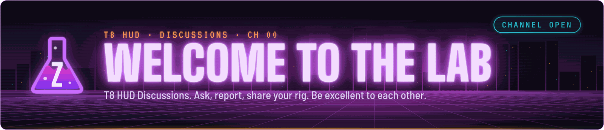

<p align="center"></p>

## 👋 Pull up a chair

This is the T8 HUD corner of **ZRolesLabs**: a place for people who like seeing what their Eversolo is actually doing. Ask questions, report how the HUD behaves on your player, pitch ideas, show off your rig, or just talk music.

No algorithm, no ads, no engagement bait. Humans talking to humans about hi-fi. 🎧

## 🧭 Where things go

| | Category | Use it for |
| --- | --- | --- |
| 🆘 | **Help** | Stuck installing or setting up? Ask here, and mark the reply that fixed it. |
| 📡 | **Streamer Reports** | Running a **T10, DMP-A6/A8/A10**, or a source we haven't tested (Qobuz, Roon, AirPlay, DLNA…)? Tell us how the HUD did. This is how support for new hardware happens. |
| 💡 | **Ideas** | Features you'd like. 👍 the ones you want most. |
| 🖥️ | **Show Your Rig** | The HUD in the wild: your screen, your chain, your palette. |
| 💬 | **The Lounge** | Everything else. |
| 🗳️ | **Polls** | Help decide what the lab builds next. |
| 📣 | **Announcements** | New releases. Hit **Watch → Custom → Releases** on the repo to hear about them. |

## 🧪 The one trick that helps with everything

While a track is playing, open the HUD's raw-data page and paste the text into your post:

```
http://<HUD-address>:8080/api/raw
```

It's exactly what your player told the HUD, so we can see what you see. It holds track and player info, nothing private, but give it a glance before posting.

## 📚 Start here

- 📖 **[The wiki](https://github.com/ZRolesLabs/t8-hud/wiki)**: install guides, the setup page, lyrics, troubleshooting.
- ⬇️ **[Latest release](https://github.com/ZRolesLabs/t8-hud/releases/latest)**
- 🐛 Pretty sure it's a bug? **[Open an issue](https://github.com/ZRolesLabs/t8-hud/issues/new/choose)**.
- 🛡️ Security problem? **Not here, please.** Use the **[private report form](https://github.com/ZRolesLabs/t8-hud/security/advisories/new)**.

## 🤝 House rules

1. **Be excellent to each other.** Everyone here started somewhere.
2. **Keep it real.** The HUD never shows fake data, and we try not to post it either.
3. **Mind your privacy.** Check screenshots and photos for IP addresses, names or anything else you'd rather keep at home.
4. **Be patient.** It's a one-person lab, run for the love of it.

## 💜 What we stand for

T8 HUD is **UN-enshittified**: read-only, LAN only, no accounts, no tracking, no telemetry, no ads. Lyrics and the online lookup are both off unless you switch them on. That's not changing.

Welcome aboard. Now go play something good. 🎶

<sub>— ZRolesLabs · not affiliated with Eversolo</sub>
