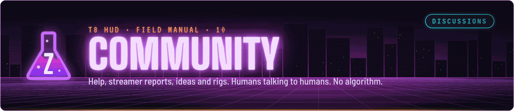

<p align="center"></p>

T8 HUD has a home for humans: **[Discussions](https://github.com/ZRolesLabs/t8-hud/discussions)**. No algorithm, no ads. Just people who like seeing what their Eversolo is doing.

| | Where | For |
| --- | --- | --- |
| 🆘 | **[Help](https://github.com/ZRolesLabs/t8-hud/discussions/categories/help)** | Stuck installing or setting up |
| 📡 | **[Streamer Reports](https://github.com/ZRolesLabs/t8-hud/discussions/categories/streamer-reports)** | T10, DMP-A6/A8/A10, untested sources. How new hardware gets supported |
| 💡 | **[Ideas](https://github.com/ZRolesLabs/t8-hud/discussions/categories/ideas)** | Features you'd like. 👍 the ones you want |
| 🖥️ | **[Show Your Rig](https://github.com/ZRolesLabs/t8-hud/discussions/categories/show-your-rig)** | The HUD in the wild |
| 💬 | **[The Lounge](https://github.com/ZRolesLabs/t8-hud/discussions/categories/the-lounge)** | Everything else |
| 🐛 | **[Issues](https://github.com/ZRolesLabs/t8-hud/issues/new/choose)** | Bugs, with the short bug form |
| 🛡️ | **[Private security report](https://github.com/ZRolesLabs/t8-hud/security/advisories/new)** | Security problems. Never post those in public |

## ▸ How to help (no code needed)

1. **Send a streamer report.** Got a player or source marked ❔ on [Works with](Works-With)? Play something, open `/api/raw`, post it in Streamer Reports. That's usually all it takes.
2. **Fix a lyric for everybody.** Missing words or wonky timing come from [LRCLIB](https://lrclib.net), and anyone can improve it, for example with [LRCGET](https://github.com/tranxuanthang/lrcget).
3. **Star the repo** so other Eversolo owners find it.
4. **Tell a friend** with a T8. Word of mouth is the only marketing we do.

## ▸ Want to hack on it?

```
npm test                 # the payload normaliser and the lyrics logic
node test/fake-t8.js     # a stand-in T8 on port 19529 (SAMPLE=tidal, LYRICS=1)
node server.js --demo    # replay a recorded T8
```

Plain Node.js, zero dependencies, MIT. New features follow the house rules: **everything on screen is real**, anything that touches the internet is **off by default**, and **no accounts, ever**.
