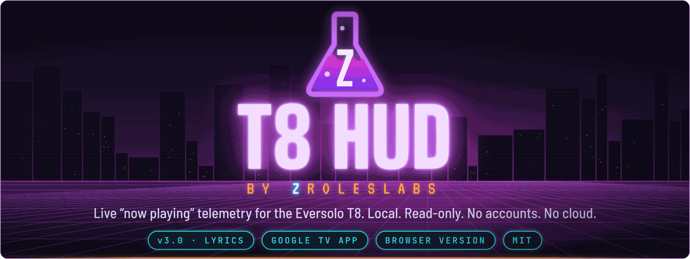
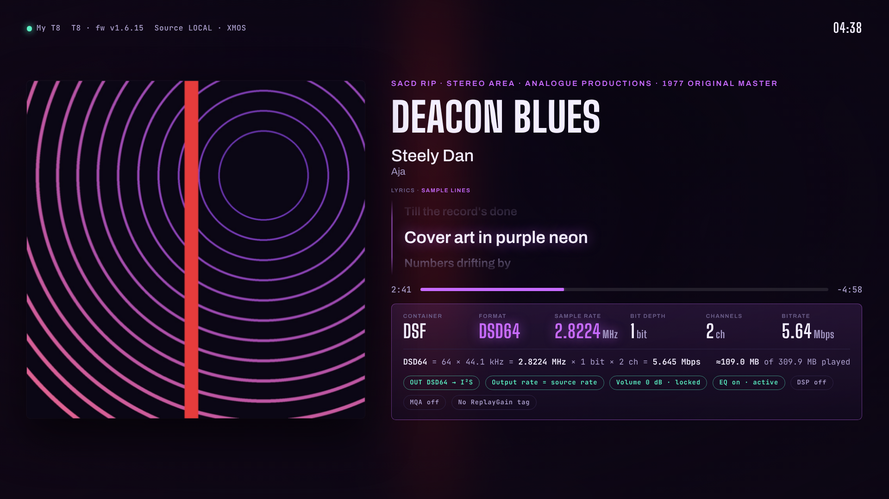
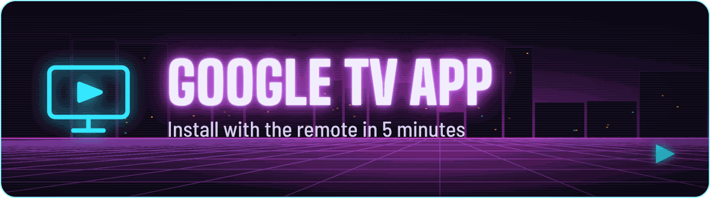
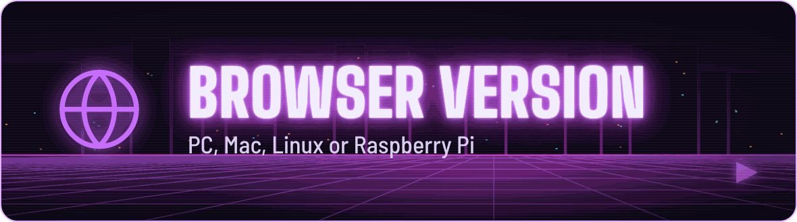
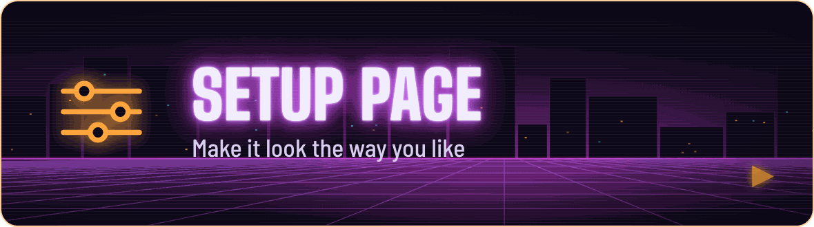
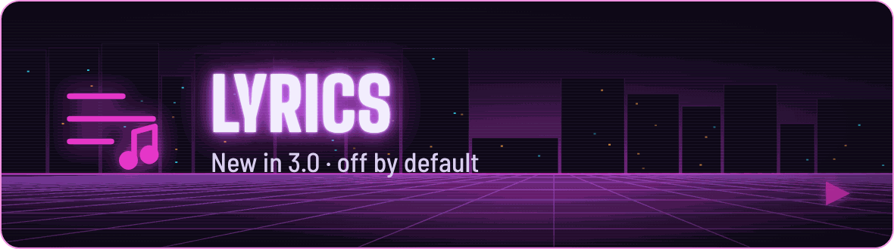
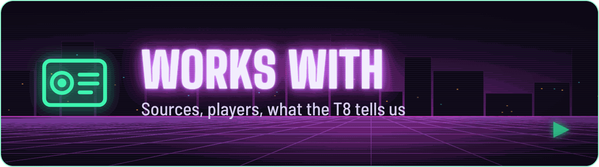
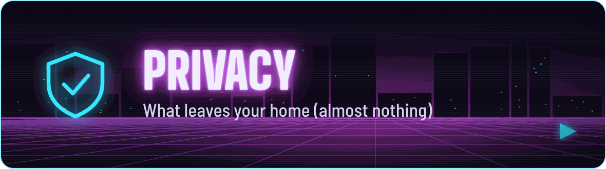
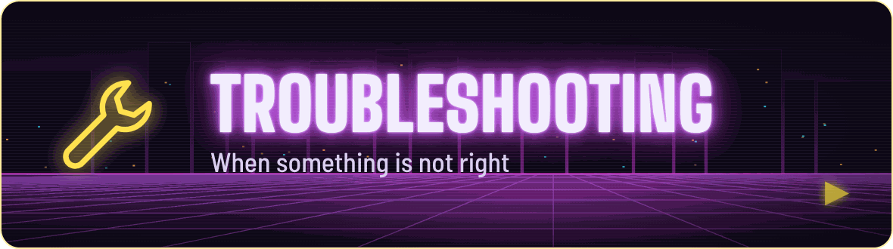
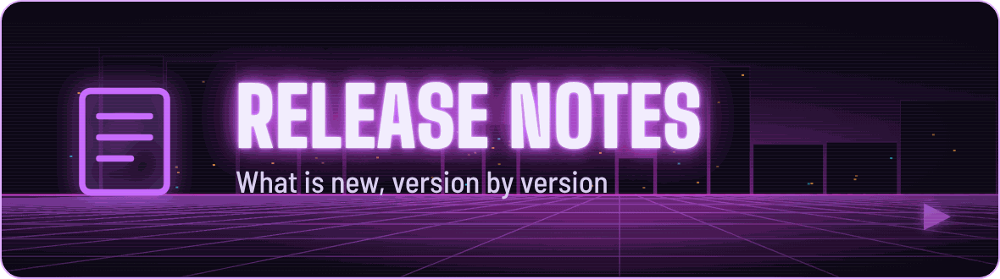

<b>Welcome to the T8 HUD field manual.</b> 
An UN-enshittified, read-only, account-free "now playing" display for the Eversolo T8. 
Big cover art, the real stream format, live telemetry and (new in 3.0) lyrics, on any screen in your house.

<a href="https://github.com/ZRolesLabs/t8-hud/releases/latest"><b>▸ Get the latest release</b></a> &nbsp;·&nbsp; <a href="https://github.com/ZRolesLabs/t8-hud"><b>▸ Source code</b></a> &nbsp;·&nbsp; <a href="https://github.com/ZRolesLabs/t8-hud/issues/new/choose"><b>▸ Report a bug</b></a>

## ▸ Pick your path

## ▸ What it is

| | Google TV app | Browser version |
| --- | --- | --- |
| **Runs on** | The TV itself (Google TV or Android TV, Android 7+) | Any always-on computer with Node.js 18+ |
| **Shows on** | That TV | Any browser at home: TV, tablet, phone, laptop |
| **Finds your T8** | By itself | By itself, or **Find my T8** on the setup page |
| **Updates** | Installs its own updates from GitHub | Unzip the new release over the old one |
| **Start here** | [Install on Google TV](Install-on-Google-TV) | [Browser version](Browser-Version) |

Both show the same screen: cover art, track info, telemetry, a clock and (if you switch them on) lyrics.

## ▸ The rules it lives by

> **Everything on screen is real.** It's either reported by the T8 or typed in by you. No fake level meters. No invented specs. When the T8 doesn't send a value, the box says **N/A** instead of guessing.

- 🔒 **Read-only.** It reads the T8's local API (port 9529) and never sends your player a command.
- 🏠 **Your network only.** No accounts, no sign-ups, no cloud, no telemetry, no ads.
- 🌐 **Almost nothing leaves home:** cover art for streamed tracks, the TV app's update check, and lyrics lookups only if you switch them on. The full list is on [Privacy & security](Privacy-and-Security).
- 📦 **Zero npm dependencies.** Plain Node.js and bundled fonts.

## ▸ Need a hand?

- 🤖 Not a settings person? [Let an AI walk you through it](Let-an-AI-Help), one step at a time.
- 🐛 Something wrong? [Open an issue](https://github.com/ZRolesLabs/t8-hud/issues/new/choose). Pasting the raw-data page (`/api/raw`) while the track plays is the single most useful thing you can add.
- 🛡️ Found a security problem? Please report it privately, see [Privacy & security](Privacy-and-Security#reporting-a-security-problem).

ZRolesLabs is not affiliated with Eversolo or LRCLIB. The HUD reads the same local HTTP API the Eversolo Control app uses.
