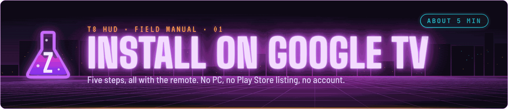
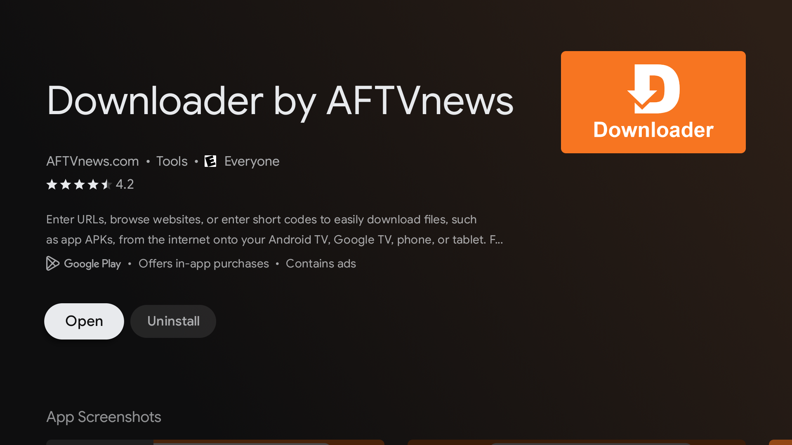
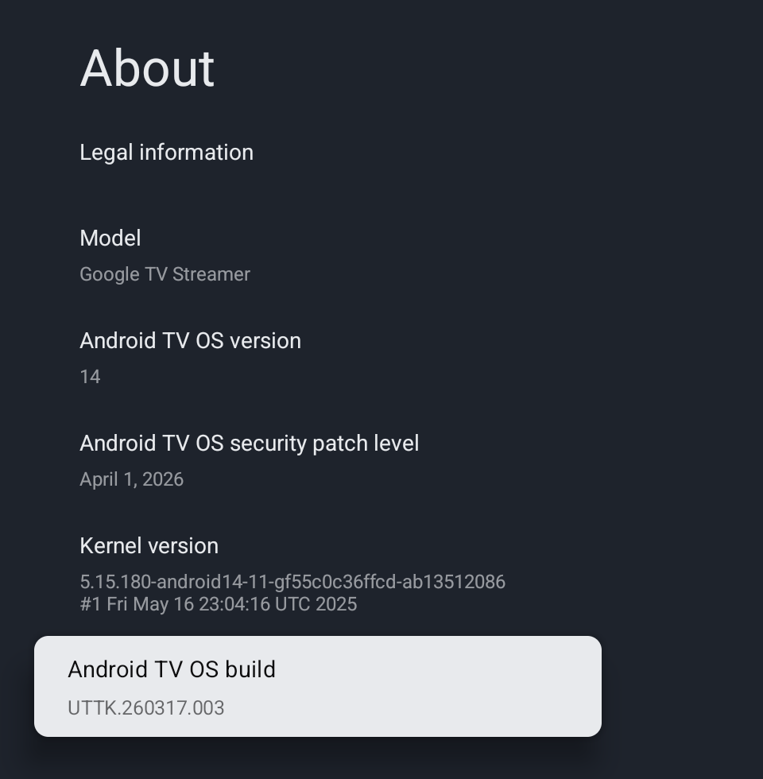
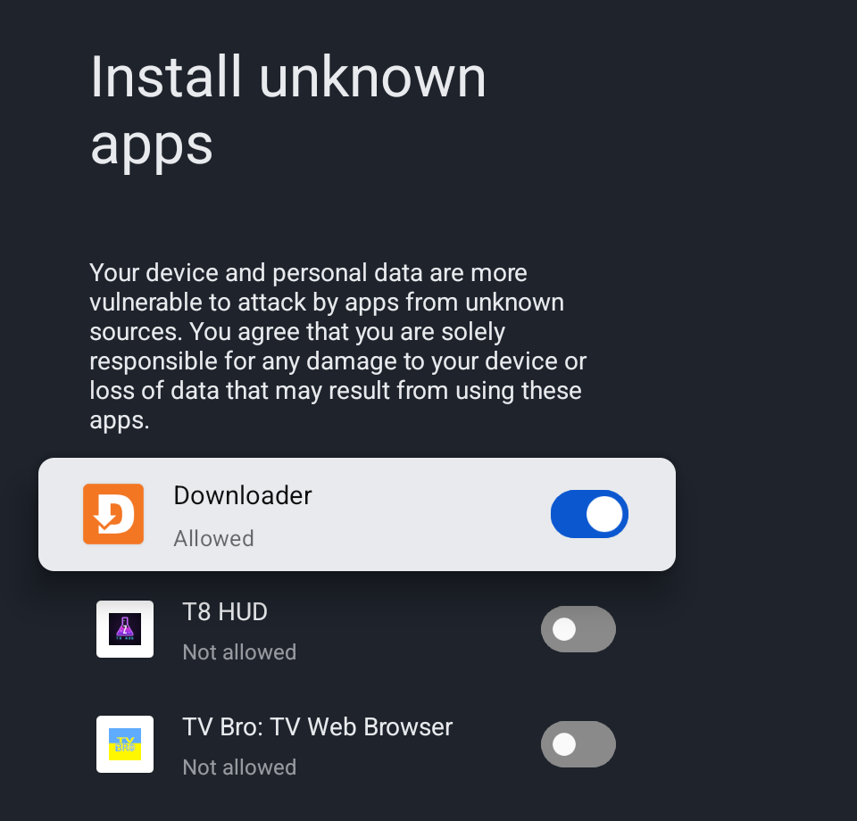
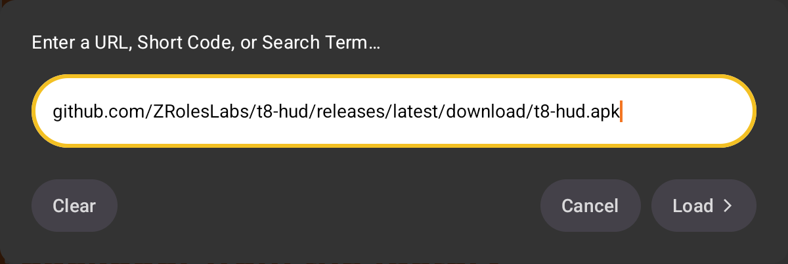
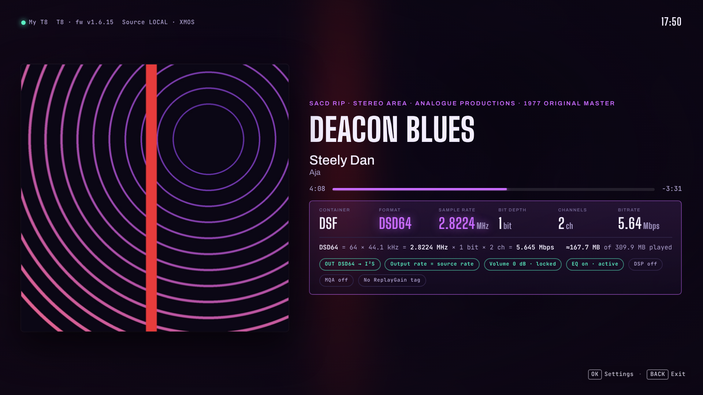
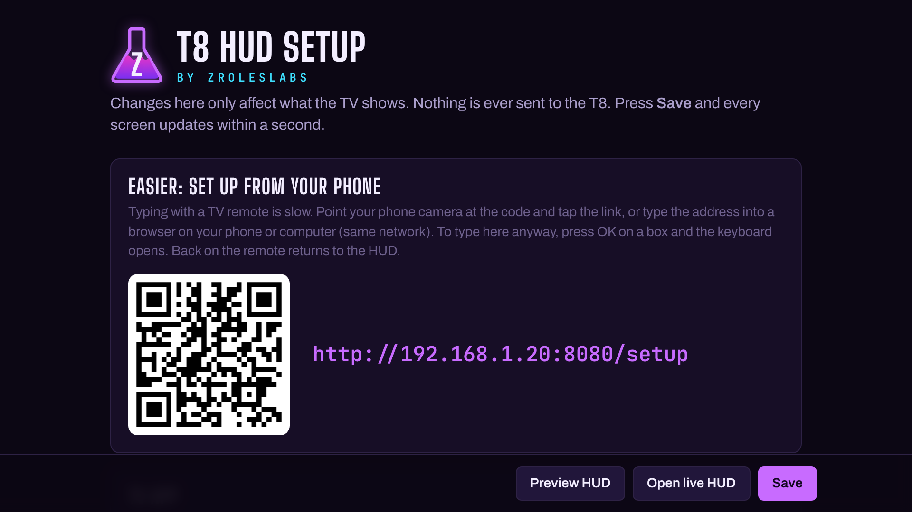
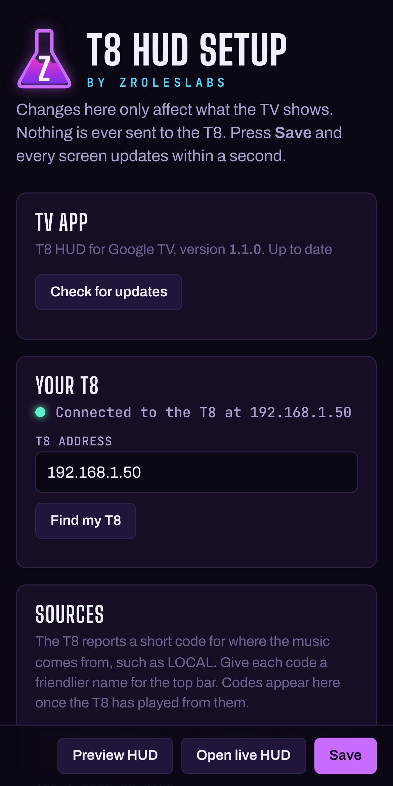

<p align="center"></p>

The easiest way to run T8 HUD. The app runs on the TV itself, finds the T8 by itself and talks to it directly. **No PC, no Pi, no account and no Play Store listing.** It keeps the screen awake while the HUD is up, so Google TV's ambient mode stays away.

> **You need:** a Google TV or Android TV device on Android 7 or newer (Google TV Streamer, Chromecast with Google TV, or a TV with Google TV built in), on the same network as your T8. Tested on a Google TV Streamer (Android TV 14). Fire TV and other Android boxes will probably work too, and reports are welcome.
>
> 🤖 Rather have someone hold your hand? [Let an AI walk you through it](Let-an-AI-Help#google-tv-app).

## ▸ 01 · Get the Downloader app `[TV]`

Open the Google Play Store on the TV, search for **Downloader** and install the orange one **by AFTVnews**. It's a free, well-known app for downloading files onto a TV.

> [!WARNING]
> **Watch out for lookalikes.** The search also shows apps such as "Downloader TV: APK Installer". Those are not the same thing. The right one says **AFTVnews** under the name and has the orange **D** icon.



## ▸ 02 · Turn on developer mode `[TV]`

Go to **Settings → System → About**, scroll to the bottom, then press OK on **Android TV OS build** 7 times, until it says "You are now a developer!". Google TV hides the switch in the next step until you do this.



## ▸ 03 · Let Downloader install apps `[TV]`

Go to **Settings → Apps → Security & restrictions → Unknown sources** (on some TVs: **Install unknown apps**). Switch **Downloader** on, so it says **Allowed**.



## ▸ 04 · Download T8 HUD `[TV]`

Open Downloader. If it asks for permission to access files, choose **Allow**. Select the address box at the top:


Type this address exactly (it's case-sensitive), then press **Load**:

```
github.com/ZRolesLabs/t8-hud/releases/latest/download/t8-hud.apk
```



When the download finishes, press **Install**. If Android says Downloader isn't allowed to install apps, press **Settings**, switch Downloader on, press **Back** and try again. When it says "App installed", press **Done** (or **Open** to start straight away). Downloader then offers to delete the downloaded file: say yes, it's no longer needed.

## ▸ 05 · Open T8 HUD `[TV]`

It's under Apps: scroll to the end of "Your apps", or open "See all apps". Make sure the T8 is switched on (not in standby). The screen says "Looking for your T8 on the network…" and finds it within about 10 seconds.



**Tidy-up (optional):** switch Downloader off again under Unknown sources, or uninstall it. T8 HUD installs its own updates and asks for its own permission the first time.

---

## ▸ Using it

| Remote | What happens |
| --- | --- |
| **Any button** | A small menu appears in the corner: **Settings · Lyrics · About · Exit** |
| **Left / Right, OK** | Move along the menu, pick an item |
| **Lyrics** | Switches lyrics on or off right there, without leaving the HUD |
| **Menu** (if your remote has one) | Straight to Settings |
| **Back** | Closes the menu. Back on the HUD closes the app |

The HUD itself is clean: no buttons or hints on screen while music plays.

### Set it up from your phone

Typing with a remote is slow, so the setup page shows a **QR code**. Point your phone camera at it, tap the link, and the same setup page opens on your phone. You can also type the address shown next to it (for example `http://192.168.1.20:8080/setup`) into any browser on the same network. Changes you save on the phone show on the TV straight away. The remote works on that page too: the arrows go row by row, and the on-screen keyboard only opens when you press OK on a box.

<p>


</p>

All the options are explained on [The setup page](Setup-Page).

### Updates

The app checks GitHub for a new version every so often. When one is out, the HUD mentions it briefly and the top of the setup page says **Update ready** with **Install update** already selected: press OK. The first time, Android asks you to allow T8 HUD to install apps: say yes. Your settings stay as they are.

### Pin it

In "Your apps", hold OK on T8 HUD and choose **Move**, to put it at the front.

<p align="right"><b><a href="Setup-Page">Next: The setup page ▸</a></b></p>
