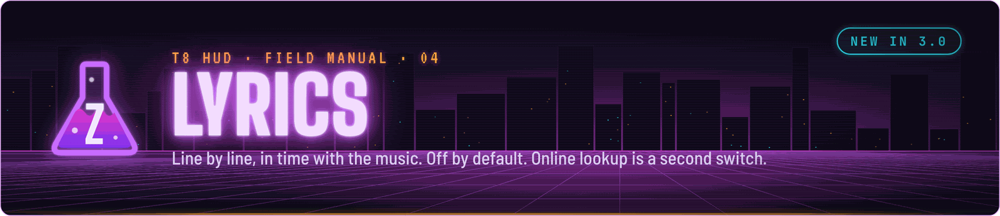
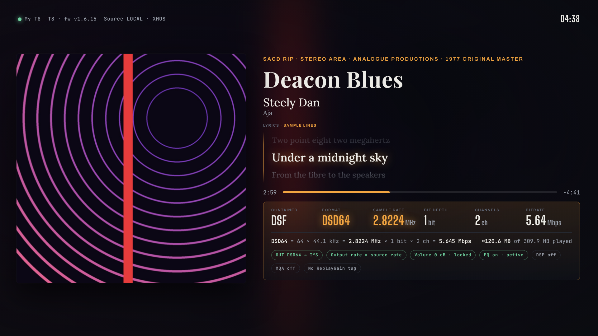

Version 3 teaches the HUD to sing along. Switch it on and the words appear under the album name: **three lines**, with the line being sung full size and lit in the format colour. Everything else stays exactly where it was, because a lyrics feature that bulldozes the layout isn't a feature.

The lyric lines in the screenshot are sample lines written for the preview, not the words of the song on screen.

## ▸ Two switches, both off

| Switch | Where | Default | What it does |
| --- | --- | --- | --- |
| **Show lyrics** | Setup page, or **Lyrics** in the TV app's remote menu | ⬛ Off | Shows lyrics the T8 already has. Nothing leaves your network. |
| **Look up missing lyrics on LRCLIB** | Setup page | ⬛ Off | Asks [LRCLIB](https://lrclib.net) for tracks the T8 has no lyric for. The only way lyrics ever touch the internet. |

## ▸ Where the words come from

**1 · The T8 itself.** For tracks in its own library, the T8 can hold a lyric (the same one the Eversolo app shows). The HUD asks the T8 for it, once per track, over the same read-only local API as everything else. The label says **Lyrics · from the T8**.

> [!NOTE]
> Fair warning: our own T8 had no lyric stored for anything we played while testing, and streamed tracks (TIDAL Connect and friends) never have one. For most music, the words will come from switch number two.

**2 · LRCLIB, only if you tick the second switch.** A free, open-source lyrics database. No account, no key. When it's on:

- 📤 A lookup sends the track's **title, artist, album and length**, and nothing else: no ID, no cookies, no account. As with any website, their server sees your internet address.
- 💾 Each answer is kept by the HUD (`data/lyrics/` in the browser version, the app's own storage on a TV), so **a track is only ever asked for once**. "Nothing found" is asked again after a week.
- 🏷️ The label says **Lyrics · LRCLIB**.

Running your own copy of LRCLIB? In the browser version, add `"lyricsServer": "http://your-server:port"` to `config.json` and lookups go there instead.

## ▸ Honest by design

- ⏱️ **Timed lyrics** follow the music line by line. Three dots fill up during a break in the singing, so you can see the next line coming.
- 📏 Timed lyrics are only used when they were made for a recording of the **same length (within 3 seconds)**. Otherwise the words are shown as plain text that rolls slowly with the track, labelled **not timed**.
- 🚫 No lyrics found, an instrumental, a radio stream with no artist: no words, just one small line that says why (**none found for this track**, or **none on the T8 · online lookup is off**), so you can tell it from the HUD not working. **The HUD never invents words or timing.**
- 🎯 Words landing a beat early or late on your system? **Timing nudge** on the setup page shifts them in 50 ms steps.

## ▸ Thank you, LRCLIB 💜

The online half of this only exists because of [LRCLIB](https://lrclib.net): a free lyrics database, built in the open ([source on GitHub](https://github.com/tranxuanthang/lrclib)) and filled in by volunteers who sit down and time songs line by line so the rest of us can read along. No account. No API key. No "sign in to continue". That's exactly the kind of internet we want more of, and exactly what we mean by **UN-enshittified**.

If a song you love is missing, or the timing is off, you can fix it for everybody: LRCLIB takes contributions, and their free app [LRCGET](https://github.com/tranxuanthang/lrcget) is one way to send them in.

We try to be a polite guest: one lookup per track, answers kept on your side so we never ask twice, and a User-Agent that says who we are. T8 HUD is not affiliated with LRCLIB.

<b><a href="Works-With">Next: Works with ▸</a></b>

