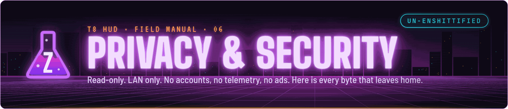

> **The ZRolesLabs prime directive:** only UN-enshittified apps. No tracking. No telemetry. No spying. No cloud accounts. Clean, functional, private, secure, nimble.

## ▸ Every connection T8 HUD makes

This is the whole list. If it isn't here, the HUD doesn't do it.

| Talks to | When | What it sends | Can you turn it off? |
| --- | --- | --- | --- |
| 🏠 **Your T8** (port 9529, your network) | All the time | Read-only requests. Never a command | It's the point of the app |
| 🖼️ **The streaming service's image server** (e.g. `resources.tidal.com`) | Once per streamed album | A request for the cover the T8 pointed to. Cached afterwards | Local files never need it |
| 🔄 **GitHub Releases** (this repo) | Google TV app, every so often | A check for a newer version | Browser version never checks |
| 🎤 **LRCLIB** (`lrclib.net`) | Only if you tick **Look up missing lyrics on LRCLIB** | Title, artist, album, length. Once per track. No ID, no cookies | ⬛ **Off by default** |

What's **not** on that list: analytics, crash reporting, ads, accounts, sign-in, "anonymous usage statistics", or a server of ours. We don't have one.

## ▸ How it's built

- 🔒 **Read-only.** It reads the T8's local API and never sends the player a command.
- 🏠 **Your network only.** The HUD and setup page listen on port 8080 for your home network. Settings changes are only accepted from local addresses.
- 🔑 **No login on the setup page, by design.** It only changes how the HUD looks. **Don't forward port 8080 to the internet.**
- 📦 **No npm dependencies.** The server is plain Node.js, so there's no package supply chain to inherit.
- 🔤 **Fonts are bundled.** No font CDNs, no web requests to draw text.
- ✍️ **Signed releases.** Google TV APKs are built by GitHub Actions in the public repo and signed with the project's release key. The app only updates itself from this repo's releases.

## ▸ Reporting a security problem

**Please don't open a public issue or discussion for a security problem.** Report it privately:

1. Go to the **[Security tab](https://github.com/ZRolesLabs/t8-hud/security)** of the repo.
2. Press **Report a vulnerability** (or go straight to **[the private report form](https://github.com/ZRolesLabs/t8-hud/security/advisories/new)**).
3. Tell us what you found, the version (Google TV app or browser version), and the steps to reproduce it. Plain words are fine.

| | |
| --- | --- |
| **First reply** | within 7 days |
| **Fix or a clear plan** | within 30 days for anything real (it's a one-person lab, and we'll say if it takes longer) |
| **Credit** | in the release notes and advisory, if you want it |
| **Supported** | 3.0.x ✅ · 1.x and 2.x ❌ please update |

**In scope:** the HUD server and its pages (including setup and `/api/raw`), the Google TV app and its self-update, anything that lets someone outside your network reach the HUD or change its settings, and release integrity.
**Out of scope:** the Eversolo T8 and its firmware (report to Eversolo), LRCLIB's servers, the streaming services' image servers, and anything that needs someone already in full control of your computer or TV.

Full policy: [SECURITY.md](https://github.com/ZRolesLabs/t8-hud/blob/main/SECURITY.md).

<b>Un-enshittified on purpose. If you find a way it isn't, we want to hear about it.</b>

<b><a href="Troubleshooting">Next: Troubleshooting ▸</a></b>

