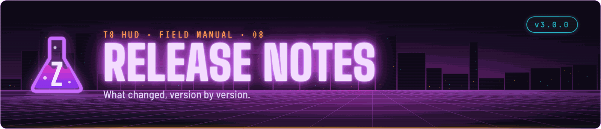

The Google TV app offers each update by itself (OK → **Settings** → **Install update**). The browser version updates by unzipping the new release over the old one. Downloads live on **[GitHub Releases](https://github.com/ZRolesLabs/t8-hud/releases)**.

## ▸ v3.0.0 · Lyrics 🎤
<code>2026-11-18</code> · <a href="https://github.com/ZRolesLabs/t8-hud/releases/tag/v3.0.0">release</a>

The #1 upgrade request. The HUD now sings along.

- **Lyrics**, three lines under the album name, the sung line lit in the format colour. Off by default.
- **From your T8 first**, over the same read-only local API. Nothing leaves your network.
- **LRCLIB lookup** for everything else: a separate switch, also off by default. Title, artist, album and length, once per track, kept on your side.
- **Nothing made up:** timed lyrics only when they fit the recording, otherwise plain text labelled "not timed". No lyrics means one small line that says why.
- **Timing nudge** in 50 ms steps.
- **Lyrics** item in the TV app's remote menu (Settings · Lyrics · About · Exit).
- **Update ready** banner at the top of the TV setup screen, with Install already selected.
- **Remote-friendly setup:** row-by-row navigation, and the keyboard only opens when you press OK on a box.

## ▸ v1.3.2 · Smoother
<code>2026-11-14</code> · <a href="https://github.com/ZRolesLabs/t8-hud/releases/tag/v1.3.2">release</a>

- Smoother progress bar: a local playhead clock that eases out drift, ignores stale positions from the T8 and never steps backwards.
- Optional **ZRolesLabs flask signature** in the bottom corner (setup page → Look). Off by default.

## ▸ v1.3.1 · New badge
<code>2026-11-07</code> · <a href="https://github.com/ZRolesLabs/t8-hud/releases/tag/v1.3.1">release</a>

- App icon in the standard ZRolesLabs cyan badge, so it sits with the other Labs apps on the home row.

## ▸ v1.3.0 · Type
<code>2026-11-06</code> · <a href="https://github.com/ZRolesLabs/t8-hud/releases/tag/v1.3.0">release</a>

- Font styles for title, artist and album: Classic, Modern, Serif, Terminal.
- Bigger artist and album text options: Standard, Large, Extra large.

## ▸ v1.2.0 · Remote menu
<code>2026-11-05</code> · <a href="https://github.com/ZRolesLabs/t8-hud/releases/tag/v1.2.0">release</a>

- Press any button on the remote for a small menu: Settings · About · Exit.
- An About screen with the version and where the project lives.

## ▸ v1.1.0 · Google TV app 📺
<code>2026-11-05</code> · <a href="https://github.com/ZRolesLabs/t8-hud/releases/tag/v1.1.0">release</a>

- The HUD as a Google TV / Android TV app. It runs on the TV and finds the T8 by itself. No computer needed.

## ▸ v1.0.1 · Browser version
<code>2026-11-04</code>

- The browser version hits 1.0 (after the 0.x builds): a zero-dependency Node.js server and a 16:9 HUD for any browser at home.

---

Coming later: a live <b>signal chain</b> (your DAC, amp and speakers drawn as a path), a DAC window, local listening stats, and real level meters if a clean way to get the audio ever turns up. Ideas welcome in <a href="https://github.com/ZRolesLabs/t8-hud/discussions">Discussions</a>.

