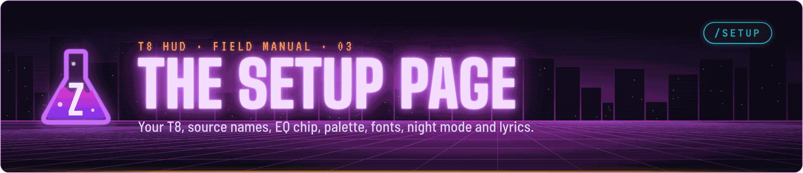
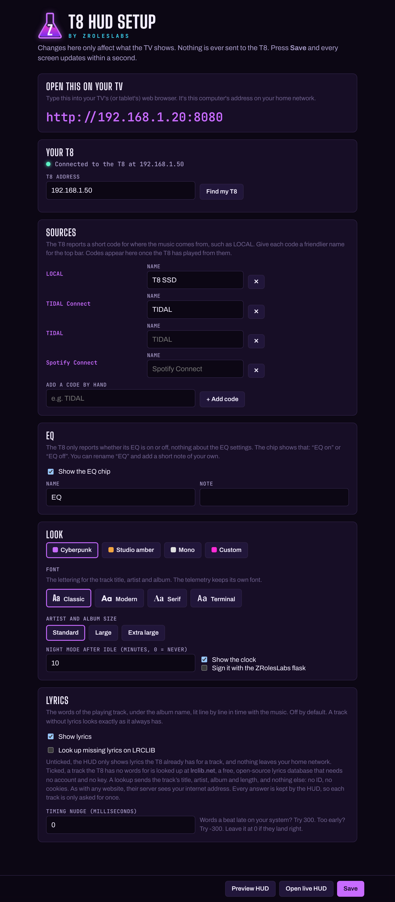

The setup page changes **how the HUD looks**, and nothing else. Nothing you do here touches a setting on your T8, because the HUD only ever reads from it.

| Version | Where to open it |
| --- | --- |
| **Google TV app** | OK on the remote → **Settings**, then scan the QR code with your phone (or type the address shown next to it, e.g. `http://192.168.1.20:8080/setup`) |
| **Browser version** | `http://localhost:8080/setup` on the HUD computer, or `http://<computer-IP>:8080/setup` from any phone or PC at home |

Changes only save from devices on your own network. Every open screen updates within a second.

## ▸ Section by section

### 📡 Your T8
Its address, and a **Find my T8** button that scans your network for any Eversolo player that answers.

### 🎛️ Sources
Friendlier names for the source the T8 reports. `LOCAL` can show as "T8 SSD", or `TIDAL Connect` as "TIDAL". A source appears in the list once the T8 has played from it, and stays there (it's remembered in `config.json`, so restarts and updates don't lose it).

### 🎚️ EQ
The T8 only reports whether its EQ is **on or off**, and the status chip shows exactly that. You can rename the label and add a short note of your own. Untick **Show the EQ chip** to hide it.

### 🎨 Look

| Setting | Choices |
| --- | --- |
| **Palette** | Cyberpunk · Studio amber · Mono · **Custom** (pick any colour) |
| **Font** (title, artist, album) | Classic · Modern · Serif · Terminal |
| **Artist and album size** | Standard · Large · Extra large |
| **Night mode** | When the HUD dims itself with nothing playing |
| **Show the clock** | On / off |
| **Sign it with the ZRolesLabs flask** | A small flask in the bottom corner. **Off by default** |

### 🎤 Lyrics
**Show lyrics**, the separate **Look up missing lyrics on LRCLIB** switch, and a **Timing nudge** (−/+ 50 ms steps). Both switches are off by default. The whole story is on [Lyrics](Lyrics).

## ▸ The buttons at the bottom

- **Preview HUD** opens the HUD with a sample track, drawn with the settings on the page right now, before you save. It's labelled **PREVIEW** so nobody mistakes it for your T8. With lyrics ticked, it shows sample lines, labelled as such, and nothing is looked up.
- **Open live HUD** opens the real thing. It's greyed out until the T8 answers.

## ▸ Google TV extras

- **Update ready** appears at the very top of the TV's setup screen when a new version is out, with **Install update** already selected. Press OK.
- **Remote-friendly:** up and down go row by row and never skip a tick box. The on-screen keyboard only opens when you press OK on a text box, so you can arrow straight past the ones you don't want to change.

<b><a href="Lyrics">Next: Lyrics ▸</a></b>

