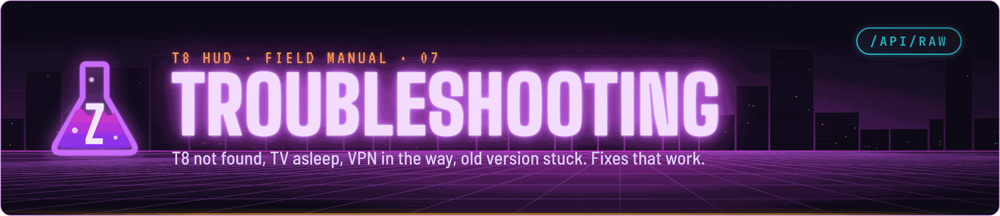

<p align="center"></p>

> 🧪 **The single most useful thing for any problem:** open the raw-data page while the track plays and keep the text. `http://<computer-IP>:8080/api/raw` for the browser version, or the TV app's setup address with `/api/raw` on the end.

## ▸ Finding the T8

<details>
<summary><b>"T8 asleep or offline"</b></summary>

The T8 drops its network API when it's in standby. Waking it brings the HUD back. Setting **Other Settings → Power Mode → Startup after power plug in** on the T8 brings it back after a power cut too.
</details>

<details>
<summary><b>The Google TV app keeps saying "Looking for your T8 on the network…"</b></summary>

1. Make sure the T8 is **on** (not in standby).
2. Make sure the T8 and the TV are on the **same network**, not a guest Wi-Fi.
3. Open the setup page (OK on the remote → **Settings**, or the address from your phone) and press **Find my T8**.
4. Still nothing? Type the T8's address by hand. The T8 shows it under **Settings → Network Settings**.
</details>

<details>
<summary><b>Find my T8 finds nothing (browser version)</b></summary>

"Same network" means the **same subnet**. Find my T8 checks every address on the computer's own network, so it won't reach a T8 on a guest Wi-Fi, a separate VLAN, or a Wi-Fi with client / AP isolation turned on. Type the T8's address in by hand instead.
</details>

<details>
<summary><b>The T8's address keeps changing</b></summary>

Set a static IP on the T8 itself (**Settings → Network Settings**) outside your router's DHCP pool. If the T8 sits behind a Wi-Fi bridge, a router reservation may not stick, because bridges often share one MAC between devices. The HUD searches for the T8 by itself if it goes missing.
</details>

## ▸ Getting the HUD on screen

<details>
<summary><b>The TV or phone times out, but <code>http://localhost:8080</code> works on the HUD computer</b></summary>

Something on that computer is dropping connections from your network. The usual cause is a **VPN app** (Proton VPN, NordVPN and others): its kill switch or "block LAN" setting can block your TV even while the VPN is disconnected. Turn on the VPN's **allow LAN connections** option, quit the app, or uninstall it, then reload the page on the TV. Also check the firewall rule from the [Windows boot recipe](Browser-Version#-run-it-at-boot).
</details>

<details>
<summary><b>Downloader says the download failed</b></summary>

Check the address letter by letter: it's case-sensitive (`ZRolesLabs`). If a release has only just been published, wait a few minutes and try again.

```
github.com/ZRolesLabs/t8-hud/releases/latest/download/t8-hud.apk
```
</details>

<details>
<summary><b>The TV shows an old version (browser version)</b></summary>

Some TV browsers cache hard. On Google TV: **Settings → Apps → TV Bro → Force stop**, then **Clear data**, then reopen.
</details>

## ▸ Staying on screen

<details>
<summary><b>The whole HUD stops answering after a while (Windows)</b></summary>

Windows puts the computer to sleep after 30 minutes by default, and the HUD sleeps with it. **Settings → System → Power (or Power & battery) → Screen and sleep** → set "put my device to sleep" to **Never** (the screen can still turn off). If it still drops: **Device Manager → Network adapters → your Ethernet adapter → Power Management** → untick "Allow the computer to turn off this device to save power".
</details>

<details>
<summary><b>The TV goes to its screensaver or switches itself off (browser version)</b></summary>

This is the TV, not the HUD. The Google TV app keeps the screen awake by itself; a web page can't. Turn the timers off on the TV or TV box:

- **Google TV:** Settings → System → Ambient mode → Start ambient mode after → **Never**, and Settings → System → Power & Energy → Energy saver (or "Turn off display") → **Never**.
- If the browser runs on a stick or box (Chromecast, Fire TV, Apple TV), that box's own sleep timer counts too, and with HDMI-CEC on it can switch the TV off when it sleeps.
- On other TVs look for "screensaver", "auto power off", "sleep timer" or "no signal power off".
</details>

<details>
<summary><b>The TV page freezes after days of running</b></summary>

Some TV browsers get sluggish when left open for days. The HUD page reloads itself once a day while nothing is playing; if it still freezes, close and reopen the browser. For a cleaner full-screen look, use your browser's full-screen or kiosk option (TV Bro has one in its menu).
</details>

## ▸ Lyrics

<details>
<summary><b>Lyrics are on but nothing shows</b></summary>

Look for the small status line under the album name. It always says why:

| It says | Meaning |
| --- | --- |
| **Lyrics · looking…** | A lookup is on its way |
| **none on the T8 · online lookup is off** | The T8 has no lyric for this track. Tick **Look up missing lyrics on LRCLIB** if you want online lookups |
| **none found for this track** | Neither the T8 nor LRCLIB has it. You can [add it to LRCLIB](https://github.com/tranxuanthang/lrcget) for everybody |
</details>

<details>
<summary><b>The words are a beat early or late</b></summary>

**Timing nudge** on the setup page shifts them in 50 ms steps.
</details>

## ▸ Still stuck?

- 💬 Ask in **[Discussions → Help](https://github.com/ZRolesLabs/t8-hud/discussions)**.
- 🐛 Pretty sure it's a bug? **[Open an issue](https://github.com/ZRolesLabs/t8-hud/issues/new/choose)** and paste the `/api/raw` text.
- 🤖 Or [let an AI help](Let-an-AI-Help) talk you through it.
