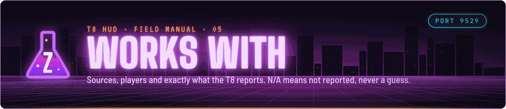

<p align="center"></p>

## ▸ Sources

| Source | Track info | Cover art | Format telemetry |
| --- | :---: | --- | --- |
| 💽 **Local files** (T8 SSD, USB, network shares) | ✅ | from the T8 | full, including file bitrate |
| 🌊 **TIDAL** in the T8's own app | ✅ | TIDAL cover | full, including stream bitrate |
| 🌊 **TIDAL Connect** | ✅ | TIDAL cover | rate, bit depth, channels, container. No bitrate from the T8, so **N/A** |
| 🟢 **Spotify Connect** | ✅ | Spotify cover | rate, bit depth, channels. The T8 only reports decoded PCM, so container and bitrate show **N/A** |
| Qobuz, HIGHRESAUDIO, Amazon Music, Deezer (in-app) | ⚠️ untested | expected | expected to work like in-app TIDAL |
| Qobuz Connect, Roon Ready, DLNA/UPnP, Squeeze Connect | ⚠️ untested | when the T8 provides one | what the T8 reports |
| Bluetooth, AirPlay | ⚠️ untested | when the T8 provides one | what the T8 reports |

Tested on firmware **v1.6.15** with local files, in-app TIDAL, TIDAL Connect and Spotify Connect. The author's T8 runs on SFP fibre with Wi-Fi and Bluetooth switched off, which is why those two are untested.

> [!IMPORTANT]
> **N/A is on purpose.** When a box says **N/A · not reported by …**, the T8 simply doesn't send that value for the source. With Spotify Connect the T8 only reports the decoded output (PCM 44.1/16), not whether Spotify sent Ogg or FLAC, or at what bitrate. The HUD won't fill the gap with a guess, or dress the decoded PCM rate up as a stream bitrate. The line under the boxes still shows the real raw PCM figure.

**Using an untested source?** Open the raw-data page while it plays and post the text in [Discussions → Streamer reports](https://github.com/ZRolesLabs/t8-hud/discussions) or an [issue](https://github.com/ZRolesLabs/t8-hud/issues/new/choose). That's the fastest way to get it confirmed or fixed.

```
http://<computer-IP>:8080/api/raw          browser version
http://<TV-address>:8080/api/raw           Google TV app (the address on its setup page)
```

## ▸ Other Eversolo players

The HUD reads the same local API that the Eversolo Control app uses, so it should work on any Eversolo streamer that speaks it.

| Player | Status |
| --- | --- |
| **DMP-T8** | ✅ Built and tested on it (firmware v1.6.15) |
| **DMP-T10** | 🟡 Same OS as the T8, should work the same |
| **DMP-A6 / A8 / A10** | 🟡 Appear to share the API. While a digital input is selected, the player sends no track info, so the HUD shows "Nothing playing" instead of guessing |

**Find my T8** and the automatic search look for any player that answers on that API, whatever the model, so "T8" in the name is just the name. If yours isn't found, type its address by hand on the setup page.

> 🙋 **Got a model other than the T8?** Play something, open the raw-data page and post the text with your model and firmware version. That's usually all it takes to add proper support.

## ▸ What the T8 does and doesn't tell us

From `getState` (firmware v1.6.15): track, artist, album, container, codec, sample rate, bit depth, channels, bitrate, file size, output codec and rate, output interface, volume and lock, EQ/DSP/sub/MQA flags, and ReplayGain when the file is tagged.

<details>
<summary><b>For the curious: how the HUD reads the T8</b></summary>

- **The T8's own player** (`playType` 5: local files and in-app TIDAL/Qobuz): the track is in `playingMusic`. Local covers come from `getImage?id=<id>&musicType=0&type=0&target=16` as a 1500 × 1500 JPEG; streamed tracks carry their own `albumArt` link. The T8 labels in-app streaming as `LOCAL`, so the HUD reads the service from the stream's own fields (`streamId`, `streamUrl`).
- **Connect sources** (`playType` 6, e.g. "Tidal connect", "Spotify connect"; AirPlay, Bluetooth): the live track is in `everSoloPlayInfo.everSoloPlayAudioInfo`, with the cover in `everSoloPlayInfo.icon`. `playingMusic` still holds the last in-app track, so the HUD ignores it.
- **Lyrics:** `getState` carries `hasLyric`, which means lyrics are supported for the current source, not that this track has one. `getLyric?id=<id>&type=<type>&duration=<duration>&number=<track number>` returns the lyric file as LRC text when the T8 holds one, and the T8's catch-all error (`{"status":805,…}`) when it doesn't. Connect sources have no library id, so the T8 has no lyric for them.
- `/api/raw` on the HUD shows the T8's last answer exactly as sent.
</details>

It does **not** expose audio levels or which drive a file is on, so the HUD doesn't pretend to show them. No fake level meters, ever.

<p align="right"><b><a href="Privacy-and-Security">Next: Privacy &amp; security ▸</a></b></p>
