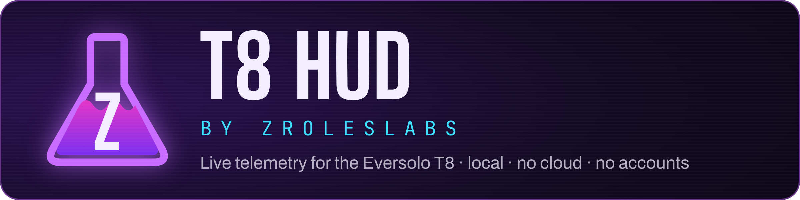
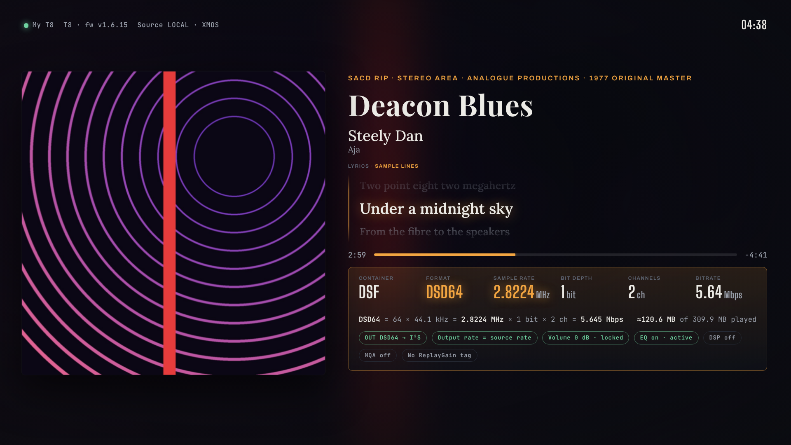

## Lyrics

T8 HUD 3.0 can show the words of the playing track: three lines under the album name, with the line being sung lit in the format colour. Nothing else on the screen moves, and a track without lyrics gets one small line that says so.

- **Off by default.** Switch it on with **Show lyrics** on the setup page, or with the new **Lyrics** item in the Google TV app's remote menu (press any button on the remote).
- **From your T8 first.** If the T8 already has a lyric for a track in its library, the HUD reads it from the T8, over the same read-only local API as everything else. Nothing leaves your network. Our own T8 had none stored for anything we played while testing, so for most music you will want the next switch.
- **Online lookup is a separate switch, also off by default.** Tick **Look up missing lyrics on LRCLIB** and tracks the T8 has no words for are looked up at [lrclib.net](https://lrclib.net), a free, open-source lyrics database with no account and no key. A lookup sends the title, artist, album and length, and nothing else. Each track is only asked for once; the answer is kept by the HUD.
- **Nothing made up.** Timed lyrics are only used when they fit the recording. Otherwise the words are shown as plain text and labelled "not timed". No lyrics found means no words shown, and one small line says why (none found, or the online lookup is off).
- **Timing nudge** on the setup page, if the words land a little early or late on your system.

The lyric lines in the screenshot are sample lines written for the preview.

**Thank you, LRCLIB.** The online lookup only exists because of [LRCLIB](https://lrclib.net), a free, open lyrics database filled in by volunteers who time songs line by line. No account, no key, no “sign in to continue”. A big thank you from ZRolesLabs to the people who run it and to everyone who has ever added a lyric. Missing song or timing off? You can fix it for everybody, and their free app [LRCGET](https://github.com/tranxuanthang/lrcget) is one way to do it.

## Also new

- **Update ready, right at the top.** When a new version is out, the Google TV setup screen now says so at the top with the **Install update** button already selected. Press OK.
- **The setup screen behaves with a remote.** On the TV, up and down now go row by row and never skip a tick box, and the on-screen keyboard only opens when you press OK on a box, so you can arrow straight past the ones you do not want to change.
- The ZRolesLabs flask signature (setup page → Look) is still there and still off by default.

**Updating:** the app offers the update by itself (OK → Settings → Install update). New here? The README has the [5 steps, all with the remote](https://github.com/ZRolesLabs/t8-hud#google-tv-app).

Tested with an Eversolo T8 on firmware v1.6.15. Bugs and ideas go in the [issue forms](https://github.com/ZRolesLabs/t8-hud/issues/new/choose).
