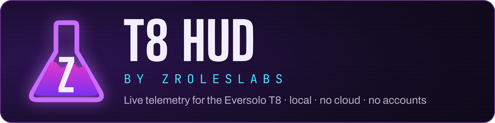

## Smoother progress bar

The progress bar no longer stutters or jumps back a second at a time. The T8 reports its position a little late and unevenly, and sometimes repeats an old one. The HUD now runs its own steady clock between reports and blends small corrections in gently. It only jumps for a real seek, a new track or a pause.

## Optional flask signature

New on the setup page under **Look**: **Sign it with the ZRolesLabs flask** puts a small flask and "ZRolesLabs" in the bottom-right corner, inside the part of the picture TVs don't crop. It's off by default, so nothing changes unless you switch it on.

**Updating:** the app offers the update by itself (OK → Settings → Install update). New here? The README has the [5 steps, all with the remote](https://github.com/ZRolesLabs/t8-hud#google-tv-app).

Tested with an Eversolo T8 on firmware v1.6.15. Bugs and ideas go in the [issue forms](https://github.com/ZRolesLabs/t8-hud/issues/new/choose).
